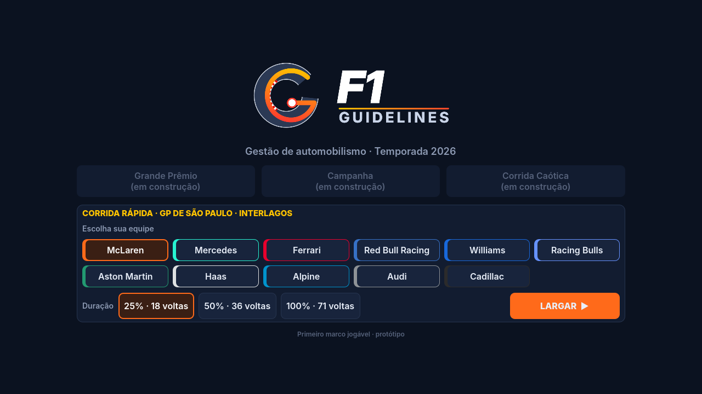
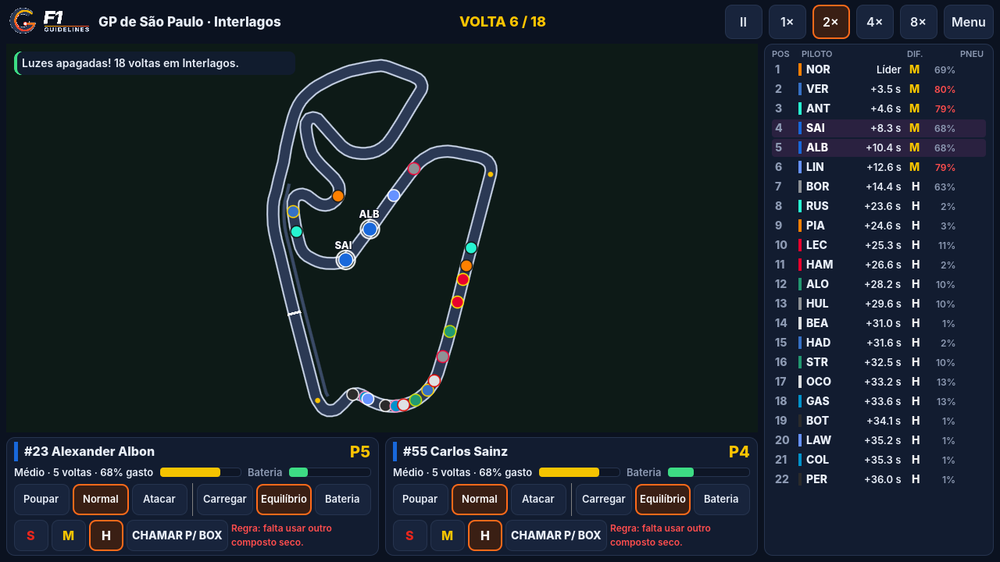
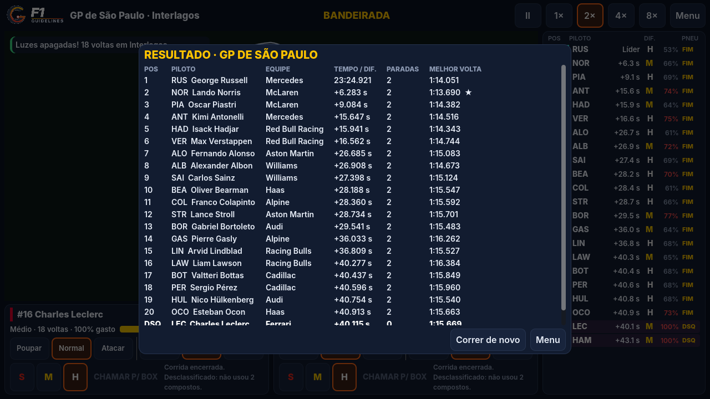

# F1 Guidelines

Jogo mobile (Android) de gestão de automobilismo, ambientado na temporada 2026.
Feito em **Godot 4.7** com GDScript.


## Estado atual
Primeiro marco jogável: corrida rápida em Interlagos com o grid de 2026, estratégia de pneus,
ordens de ritmo e energia, pit stops e IA das equipes rivais. Detalhes em `docs/ROADMAP.md`.

| Menu | Corrida | Resultado |
|---|---|---|
|  |  |  |

## Como rodar
1. Instale o Godot 4.7.2 (no Linux: `scripts/setup-godot.sh`).
2. Abra a pasta `game/` no editor do Godot e aperte F5.

Testes (dentro de `game/`):
```bash
godot --headless -d -s --path "$PWD" addons/gut/gut_cmdln.gd -gexit
```

## Documentação
- `docs/DECISIONS.md` — decisões de design
- `docs/ROADMAP.md` — marcos
- `docs/ENVIRONMENT.md` — ambiente de desenvolvimento
- `docs/THIRD_PARTY.md` — licenças de terceiros
